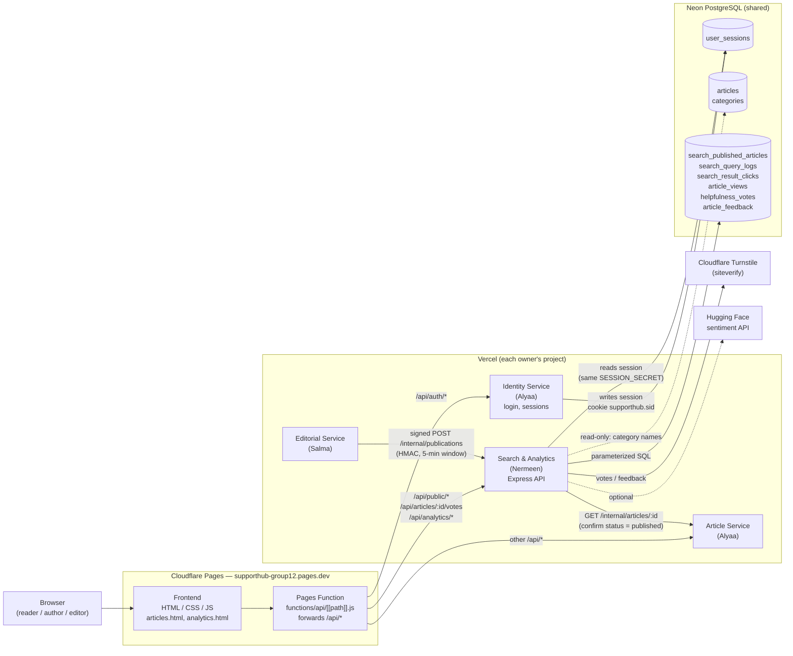
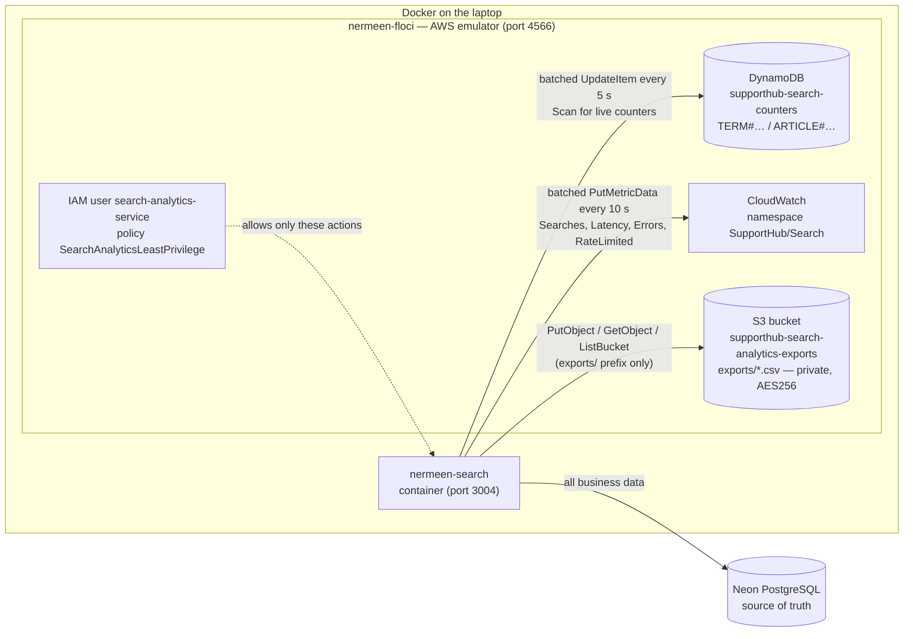
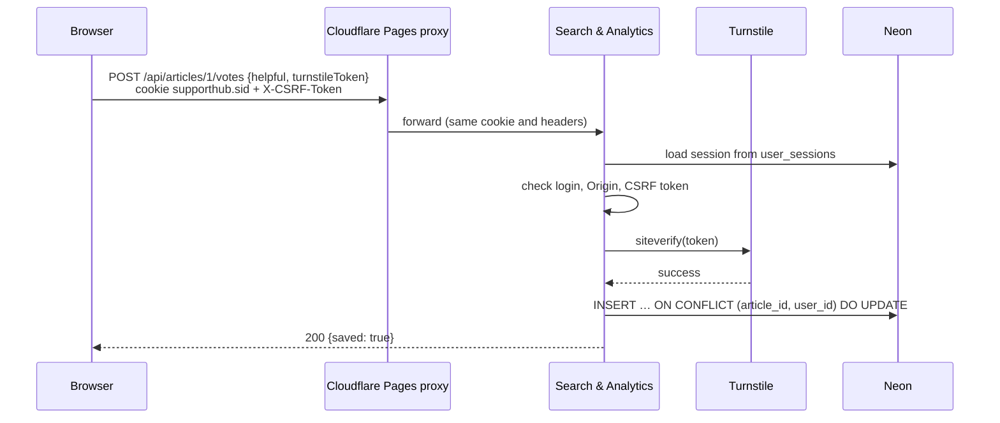

# Search, Feedback & Analytics Service — Architecture

GitHub renders the diagrams below automatically.

## 1. Whole picture

## 2. AWS on Floci (local Docker demonstration)

## 3. Request flow: a logged-in vote

## 4. Notes

| Part | Role |
|---|---|
| Express API | Stateless; routes → controllers → services; rate limit, Helmet, CORS, no-store on private data |
| Neon | Source of truth for searches, views, votes, feedback and analytics |
| Shared authentication | Identity creates the session; this service only reads it (no login code here) |
| DynamoDB | Live counters for the dashboard (not the source of truth) |
| CloudWatch | Operational metrics (traffic, latency, errors, rate limiting) |
| S3 | Private CSV exports of aggregate analytics |
| IAM | Least-privilege user: only its own table, metrics and `exports/` prefix |
| Vercel | Hosts the API online; AWS features are switched off there because Floci is local only |
| Cloudflare Pages | Hosts the frontend and forwards `/api/*`, so the session cookie stays first-party |